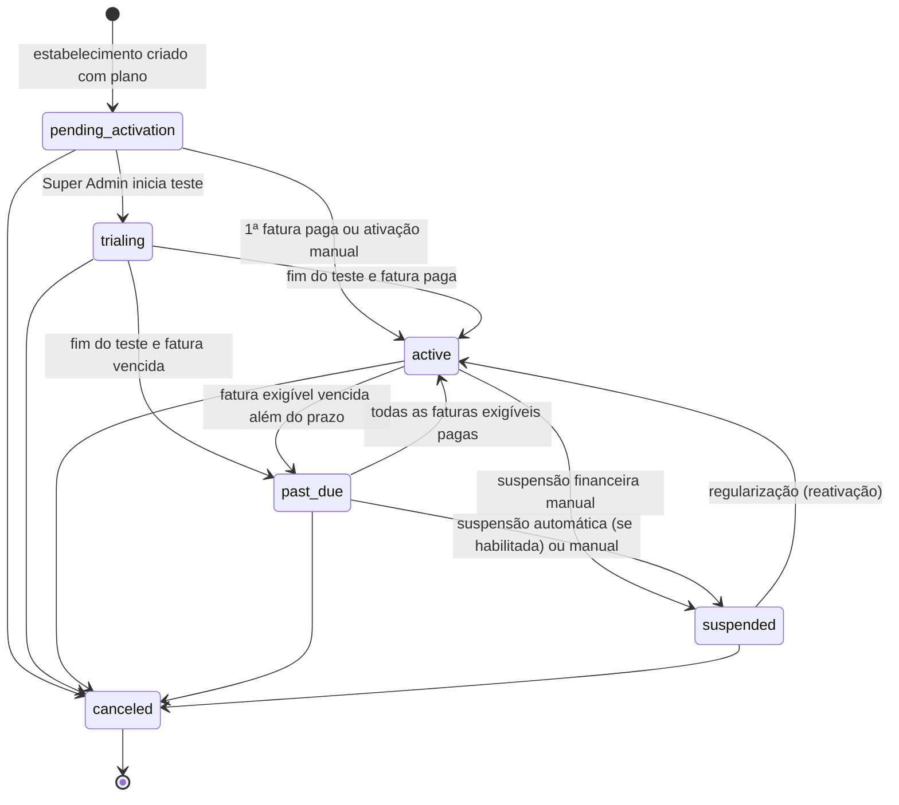
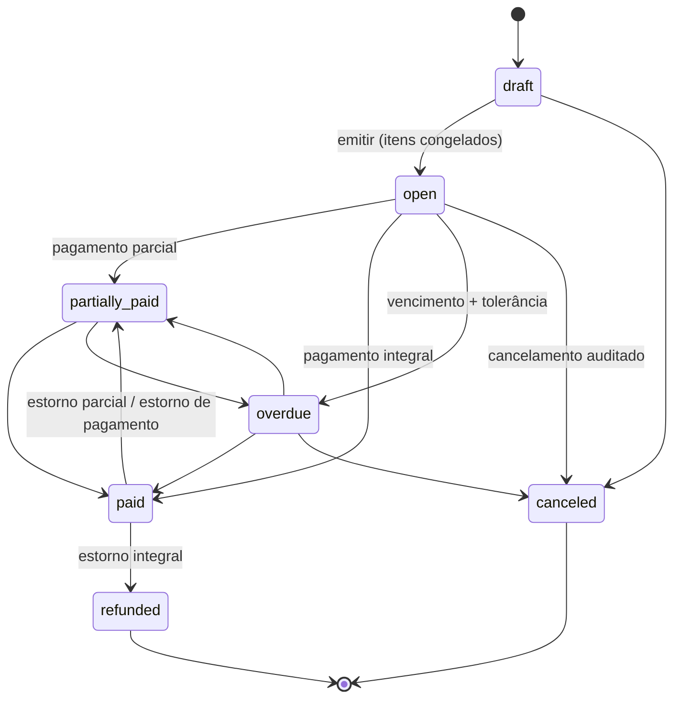
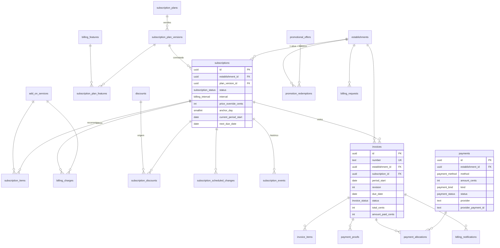
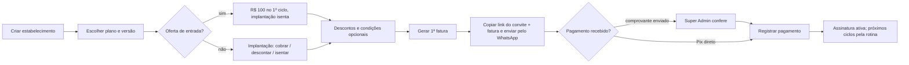

# BILLING — Monetização, assinaturas e financeiro da plataforma

> Escopo: cobrança dos **estabelecimentos contratantes** pela plataforma SaaS.
> **Fora deste documento:** pagamentos dos clientes finais pelos serviços (corte, barba...). Esses são registrados no módulo operacional (`appointment_payments`, ver [DATABASE.md §5.23](./DATABASE.md#523-appointment_payments)).
> Status: **planejado — aguardando aprovação**. Última atualização: 2026-11-25.

## Sumário

1. [Modelo de negócio](#1-modelo-de-negócio)
2. [Planos e versionamento de preços](#2-planos-e-versionamento-de-preços)
3. [Limite de profissionais](#3-limite-de-profissionais)
4. [Oferta de primeiro mês e taxa de implantação](#4-oferta-de-primeiro-mês-e-taxa-de-implantação)
5. [Serviços adicionais](#5-serviços-adicionais)
6. [Descontos e condições especiais](#6-descontos-e-condições-especiais)
7. [Assinaturas e estados](#7-assinaturas-e-estados)
8. [Ciclo de cobrança e datas](#8-ciclo-de-cobrança-e-datas)
9. [Faturas e estados](#9-faturas-e-estados)
10. [Pagamentos manuais e comprovantes](#10-pagamentos-manuais-e-comprovantes)
11. [Inadimplência e régua de cobrança](#11-inadimplência-e-régua-de-cobrança)
12. [Acesso do estabelecimento conforme situação](#12-acesso-do-estabelecimento-conforme-situação)
13. [Mudanças de plano](#13-mudanças-de-plano)
14. [Planos anuais](#14-planos-anuais)
15. [Modelagem financeira](#15-modelagem-financeira)
16. [Rotinas automáticas](#16-rotinas-automáticas)
17. [Indicadores do painel financeiro](#17-indicadores-do-painel-financeiro)
18. [Interfaces e operações administrativas](#18-interfaces-e-operações-administrativas)
19. [Integração futura com gateway](#19-integração-futura-com-gateway)
20. [Segurança e permissões](#20-segurança-e-permissões)
21. [Riscos e casos extremos](#21-riscos-e-casos-extremos)
22. [Critérios de aceitação](#22-critérios-de-aceitação)
23. [Decisões que precisam de aprovação](#23-decisões-que-precisam-de-aprovação)

---

## 1. Modelo de negócio

- Assinatura **mensal** por estabelecimento, vinculada a um plano. No futuro, também **anual** (desabilitada até ser ativada).
- Todos os planos dão acesso a todas as funcionalidades essenciais. A diferença inicial é o **limite de profissionais ativos**.
- **Sem limite** de clientes, agendamentos, serviços, horários ou histórico.
- Aquisição: **R$ 100,00 no primeiro mês, com implantação incluída**. Fora da promoção, a implantação custa R$ 149,90 (taxa única).
- Receitas complementares: serviços adicionais (implantação, importação, treinamento, sites etc.).
- Cobrança **pré-paga**: cada ciclo vence no **primeiro dia do ciclo**.
- Fase inicial **manual**: o Super Admin gera as cobranças, envia a chave Pix e confirma os pagamentos. A automação e o gateway vêm depois, **sem reconstruir o módulo**.
- Faturas são **documentos internos de cobrança**, sem valor fiscal. A emissão de NFS-e é uma expansão futura e a UI sempre exibe "Documento sem valor fiscal".

## 2. Planos e versionamento de preços

### 2.1. Catálogo inicial (inserido por migration e editável pelo Super Admin)

| Código | Plano | Mensal | Anual (futuro) | Profissionais incluídos | Profissional adicional |
|---|---|---:|---:|:-:|---:|
| `individual` | Individual | R$ 69,90 | R$ 699,00 | 1 | não permitido |
| `essencial` | Essencial | R$ 99,90 | R$ 999,00 | 2 | não permitido |
| `profissional` | Profissional | R$ 119,90 | R$ 1.199,00 | 5 | não permitido |
| `premium` | Premium | R$ 159,90 | R$ 1.599,00 | 10 | R$ 14,90/mês cada |

Nenhum preço fica no código-fonte. O código só conhece as **chaves** das funcionalidades, como `max_active_professionals`.

### 2.2. Versionamento

- `subscription_plans` guarda a identidade do plano: nome, descrição, ordem, ativo para venda e flag de promocional.
- `subscription_plan_versions` guarda as **condições comerciais imutáveis**: preço mensal, preço anual, profissionais incluídos, preço do adicional e funcionalidades. "Editar preço" **cria uma nova versão**. Uma versão já usada por alguma assinatura não pode ser alterada (trigger).
- Cada assinatura aponta para a versão contratada. Clientes antigos mantêm o preço automaticamente.
- **Reajuste**: o Super Admin escolhe as assinaturas (todas de um plano, um filtro ou uma por uma) e a data de vigência. O sistema agenda uma `subscription_scheduled_changes` para o próximo ciclo e registra auditoria. Nada muda retroativamente.
- Também é possível um **preço negociado** por assinatura (`price_override_cents` + motivo + responsável), que vale sobre a versão.

### 2.3. Funcionalidades por plano

- `billing_features` é o catálogo de chaves: `key`, nome, tipo (`boolean` | `limit`) e `is_implemented`.
- `subscription_plan_features` liga cada versão de plano às chaves (`enabled`, `limit_value`).
- Toda verificação de funcionalidade passa por `private.entitlement(establishment_id, key)`. Para criar novas limitações basta cadastrar uma chave e passar a checá-la, sem reformular o sistema.
- Chave inicial: `max_active_professionals`. As demais funcionalidades essenciais não são checadas, porque são liberadas em todos os planos.

## 3. Limite de profissionais

**Quem consome vaga:** todo registro em `professionals` com `is_active = true`, ou seja, toda pessoa que possui agenda no sistema.
- Administrador ou recepcionista que **não** atende não tem registro em `professionals`, então **não consome vaga**.
- Administrador que atende tem registro em `professionals`, então **consome vaga**.
- Profissional desativado não consome vaga, e seu histórico é preservado.
- Profissional ativo, mas oculto da página pública (`is_bookable = false`), **consome vaga**: ele continua tendo agenda e recebendo agendamentos pelo painel. Isso evita a brecha de esconder profissionais para não pagar (ver §23).

**Limite efetivo** = `profissionais incluídos na versão` + `vagas adicionais contratadas` (item recorrente `extra_professional`, só em planos com preço de adicional).

**Aplicação do limite no banco:** trigger `BEFORE INSERT OR UPDATE OF is_active` em `professionals`.
1. `pg_advisory_xact_lock` por estabelecimento, que serializa criações e ativações simultâneas.
2. Conta os profissionais ativos e compara com `private.professional_limit(establishment_id)`.
3. Se ultrapassar, gera o erro `PLAN_LIMIT_REACHED`.

A interface mostra "3 de 5 vagas em uso" e, no limite, oferece "Solicitar mais vagas" ou "Solicitar mudança de plano".

**Profissionais adicionais (Premium):** são **vagas contratadas**, não cobrança automática por uso. O administrador solicita, o Super Admin aumenta a quantidade e a próxima fatura inclui `quantidade × R$ 14,90`. Isso torna a cobrança previsível e evita surpresa na fatura.

## 4. Oferta de primeiro mês e taxa de implantação

### 4.1. Oferta (`promotional_offers`)

| Campo | Padrão inicial |
|---|---|
| Nome | "Primeiro mês com implantação completa" |
| Preço do primeiro ciclo | R$ 100,00 |
| Isenta a implantação | sim |
| Planos elegíveis | todos (configurável) |
| Data de encerramento | nenhuma (opcional) |
| Limite de participantes | nenhum (opcional) |
| Ativa | sim |

**Regras:**
- O valor promocional **substitui a mensalidade do plano no primeiro ciclo** e **isenta a implantação**. Na fatura isso aparece como uma única linha: "Oferta de entrada: plano X + implantação completa — R$ 100,00". O preço de tabela de cada componente fica guardado em `metadata` para relatórios.
- Vagas adicionais e serviços recorrentes contratados já no primeiro ciclo são cobrados normalmente, salvo condição personalizada (decisão em §23).
- O primeiro ciclo é **um mês de calendário de assinatura** (§8), não 30 dias.
- **Uso único por estabelecimento:** `promotion_redemptions` tem índice único em `(promotion_id, establishment_id)` para resgates comuns. Um novo resgate depois de cancelar e reativar exige `override_reason` e o Super Admin como responsável, com auditoria.
- **Limite de participantes:** a contagem acontece com `SELECT ... FOR UPDATE` na linha da oferta, o que impede ultrapassar o limite mesmo com resgates simultâneos.
- Não acumula com plano anual nem com outros descontos no primeiro ciclo.

### 4.2. Taxa de implantação

- Valor padrão em `billing_settings.default_setup_fee_cents` (R$ 149,90), alterável.
- Por assinatura, o Super Admin pode alterar o valor, dar desconto, isentar, incluir na primeira fatura ou cobrar em fatura separada, e anotar observações.
- É registrada como uma cobrança única (`billing_charges` com `kind = 'setup_fee'`). Um **índice único parcial por assinatura** garante que ela não seja cobrada de novo.
- Estados possíveis: `pending`, `invoiced`, `waived` (isenta) e `covered_by_promotion`.

**Exemplos:**

| Cenário | 1ª fatura | Seguintes |
|---|---:|---:|
| Essencial com oferta | R$ 100,00 | R$ 99,90 |
| Profissional com oferta | R$ 100,00 | R$ 119,90 |
| Essencial sem oferta, implantação na 1ª fatura | R$ 149,90 + R$ 99,90 = R$ 249,80 | R$ 99,90 |

## 5. Serviços adicionais

Catálogo `add_on_services`:

| Código | Serviço | Preço | Tipo | Disponível tecnicamente |
|---|---|---:|---|:-:|
| `setup` | Implantação completa | R$ 149,90 | única | sim (serviço humano) |
| `customer_import` | Importação de clientes | a partir de R$ 79,90 | única | sim (serviço humano) |
| `extra_training` | Treinamento adicional | R$ 80,00/hora | por quantidade | sim (serviço humano) |
| `whatsapp_automation` | Automação de WhatsApp | a partir de R$ 29,90 + consumo | recorrente | **não**: exibido como "em breve" |
| `landing_page` | Criação de landing page | a partir de R$ 499,90 | única | sim (serviço humano) |
| `institutional_site` | Site institucional | a partir de R$ 999,90 | única | sim (serviço humano) |
| `custom_dev` | Desenvolvimento personalizado | sob orçamento | personalizada | sim (serviço humano) |
| `extra_professional` | Profissional adicional (Premium) | R$ 14,90 | recorrente | sim |

**Campos:** nome, descrição, `price_cents` (nulo quando é sob orçamento), `price_is_starting_from`, `billing_type` (`one_time` | `recurring` | `per_unit` | `custom_quote`), `unit_label` (ex.: "hora"), `is_active`, `is_technically_available`.

**Atribuição a um estabelecimento:**
- **Recorrente**: vira um `subscription_items` com quantidade, preço personalizado, desconto, data de início e de término. Entra em todas as faturas enquanto estiver ativo.
- **Única / por quantidade / sob orçamento**: vira um `billing_charges` com o modo `next_invoice` (entra na próxima fatura) ou `standalone` (gera fatura independente na hora).

Um serviço com `is_technically_available = false` pode ser **vendido e cobrado como projeto**, mas nunca aparece no painel do estabelecimento como integração funcionando.

## 6. Descontos e condições especiais

### 6.1. Tipos

| Tipo | Valor | Exemplo |
|---|---|---|
| `percent` | pontos-base (1000 = 10%) | 10% por 3 meses |
| `fixed` | centavos | R$ 10,00 por mês |
| `free` | — | mensalidade gratuita no ciclo |

Duração: `once` (um ciclo), `repeating` (N ciclos) ou `forever`. Também há data de início e data de término opcional.

Alvo: `subscription` (itens recorrentes), `setup_fee` ou `invoice` (fatura avulsa).

### 6.2. Estruturas

- `discounts`: catálogo reutilizável e **cupons** (código único, validade e limite de resgates).
- `subscription_discounts`: desconto concedido a uma assinatura, seja de um cupom ou personalizado. Guarda nome, tipo, valor, início, término, ciclos totais e aplicados, motivo, `granted_by` e `revoked_at`.
- Preço negociado: `subscriptions.price_override_cents`.
- Período de teste: status `trialing` com `trial_ends_on`.
- Prorrogação de vencimento: altera `invoices.due_date` e preserva `original_due_date`, com auditoria.

### 6.3. Regras

- Ordem de cálculo: itens → descontos percentuais → descontos fixos → **piso em zero**. O valor aplicado de cada desconto é limitado ao saldo restante, e a constraint `invoices.total_cents >= 0` serve de garantia final.
- Desconto vira linha negativa na fatura (`kind = 'discount'`), com o valor efetivamente aplicado.
- `cycles_applied` aumenta só quando a fatura é emitida (`open`). Fatura cancelada devolve o ciclo.
- Toda concessão, alteração ou revogação vai para `audit_logs` (`billing.discount_granted` etc.).

## 7. Assinaturas e estados

### 7.1. Campos principais (`subscriptions`)

Estabelecimento · versão do plano · intervalo (`month`/`year`) · `price_override_cents` · `status` · `contracted_at` · `activated_at` · `trial_ends_on` · `anchor_day` (1–31) · `anchor_date` (data do primeiro ciclo) · `current_period_start` / `current_period_end` · `next_due_date` · forma de pagamento preferida · `setup_fee_*` · `auto_suspend_override` · `grace_days_override` · `cancel_at_period_end` · `canceled_at` / `cancel_reason` · `suspended_at` / `suspension_reason` · observações comerciais.

As vagas adicionais, os serviços recorrentes e a linha do plano ficam em `subscription_items`. Os descontos ficam em `subscription_discounts`. O histórico fica em `subscription_events`, que é append-only.

Regra: **no máximo uma assinatura não cancelada por estabelecimento** (índice único parcial). Assinaturas canceladas ficam como histórico.

### 7.2. Diagrama de estados



| Transição | Quem | Observações |
|---|---|---|
| `pending_activation → active` | sistema (1ª fatura paga) ou Super Admin | define `activated_at` e o ciclo vigente |
| `active → past_due` | rotina diária | fatura em aberto há mais de `past_due_after_days` (padrão 1) |
| `past_due → suspended` | rotina (só com suspensão automática ligada) ou Super Admin | padrão: automática **desligada** |
| `past_due/suspended → active` | sistema (quitação de todas as faturas exigíveis) ou Super Admin | a assinatura volta, mas a **suspensão administrativa** do estabelecimento é independente e continua valendo se existir |
| `* → canceled` | Super Admin (imediato ou no fim do ciclo) | dados preservados; faturas abertas continuam devidas, salvo cancelamento delas |

Todas as transições passam por **uma única função** `private.transition_subscription(id, to_status, actor, reason)`. Ela valida a tabela acima, grava `subscription_events` e `audit_logs`, e um trigger impede `UPDATE` direto de `status` fora dela.

**Reativação após cancelamento:** cria uma **nova** assinatura. A oferta de entrada não se repete, salvo override.

## 8. Ciclo de cobrança e datas

### 8.1. Regra do dia de cobrança

- O fuso de cobrança da plataforma é `billing_settings.timezone` (padrão `America/Sao_Paulo`). Todas as datas financeiras são do tipo `date` nesse fuso.
- `anchor_day` = dia da ativação ou do primeiro vencimento combinado (1–31).
- O início do ciclo *k* (k = 0, 1, 2...) é calculado **sempre a partir da âncora**, nunca do ciclo anterior. Assim o dia de cobrança não "escorrega":

```
mês_k   = mês_da_âncora + k            (ou + 12k no plano anual)
início_k = make_date(ano(mês_k), mês(mês_k), min(anchor_day, último_dia(mês_k)))
período_k = [início_k, início_{k+1})   -- intervalo meio-aberto
vencimento_k = início_k                -- pré-pago
```

| Âncora | Ciclos |
|---|---|
| 10/01 | 10/01 → 10/02 → 10/03 ... |
| 31/01 | 31/01 → 28/02 (29/02 em ano bissexto) → 31/03 → 30/04 → 31/05 |
| 29/02/2028 | 29/02 → 29/03 → ... → 28/02/2029 → 29/03/2029 |
| 30/01 | 30/01 → 28/02 → 30/03 → 30/04 |

Implementação: função SQL `private.billing_cycle_start(anchor_date, anchor_day, interval, k)`, `immutable` e coberta por testes pgTAP com todos os casos acima. Existe um espelho em TypeScript (`src/modules/billing/rules/cycles.ts`) só para pré-visualização na interface, testado contra os mesmos casos.

### 8.2. Mudança do dia de vencimento

O novo `anchor_day` vale **a partir do próximo ciclo**. O ciclo de transição é encurtado ou estendido até a nova data. **Não há cobrança proporcional automática no MVP:** o Super Admin escolhe entre "sem ajuste" (padrão) e "cobrança/abatimento manual" com valor informado. Tudo fica auditado.

### 8.3. Emissão

- A fatura do ciclo *k* é emitida como `open` `issue_days_before_due` dias antes do vencimento (padrão: 5). Isso coincide com o primeiro lembrete.
- Primeiro ciclo: a fatura é gerada no momento em que o Super Admin atribui o plano (ou como rascunho para revisão).
- **Idempotência:** índice único `(subscription_id, period_start, revision)` em faturas de ciclo. A rotina insere com `ON CONFLICT DO NOTHING`, e uma reemissão manual usa `revision + 1`.

## 9. Faturas e estados

### 9.1. Conteúdo

Número de referência (`FAT-2026-000123`, sequencial por ano) · estabelecimento · assinatura (nula em fatura avulsa) · tipo (`subscription_cycle` | `standalone`) · período · emissão · vencimento (`due_date` e `original_due_date`) · itens · `subtotal_cents` · `discount_cents` · `total_cents` · `amount_paid_cents` · `amount_refunded_cents` · `paid_at` · status · forma de pagamento · instruções de pagamento (cópia da chave Pix no momento da emissão) · observações.

Exemplo:

```
Fatura FAT-2027-000042 — fevereiro/2027 — Barbearia Central
  Plano Premium ......................................... R$ 159,90
  Profissionais adicionais (2 × R$ 14,90) ............... R$  29,80
  Automação de WhatsApp ................................. R$  29,90
  Desconto comercial .................................... -R$ 10,00
  Total ................................................. R$ 209,60
  Documento interno de cobrança — sem valor fiscal.
```

### 9.2. Estados



**Regras:**
- Depois de `open`, **itens e valores ficam imutáveis** (trigger). Só podem mudar `due_date` (prorrogação), `notes` e campos derivados de pagamentos.
- `amount_paid_cents` é **derivado**: soma das alocações de pagamentos confirmados menos estornos, recalculada por trigger em `payment_allocations`/`payments`. O status (`paid`, `partially_paid`, `overdue`) também é derivado.
- **Correção de fatura emitida:** cancelar com motivo e reemitir (nova revisão) ou lançar um item de ajuste em fatura avulsa. Nunca editar valores. Tudo vai para `audit_logs`.
- Mudança de preço de plano **nunca** altera faturas emitidas.
- Fatura `canceled` não recebe pagamento.

## 10. Pagamentos manuais e comprovantes

### 10.1. Registro (Super Admin)

- `payments`: método (`pix`, `credit_card`, `bank_transfer`, `cash`, `boleto`, `other`), valor, data de recebimento, `kind` (`payment` | `refund`), `status` (`confirmed` | `reversed`), `provider` (nulo = manual), `provider_payment_id`, observações e `recorded_by`.
- `payment_allocations`: distribui um pagamento entre uma ou mais faturas. A soma das alocações não passa do valor do pagamento, e a alocação em uma fatura não passa do saldo dela. O que sobrar fica como **saldo a alocar** e aparece na tela do estabelecimento.
- **Pagamento parcial** deixa a fatura em `partially_paid`, com saldo devedor visível.
- **Correção:** o lançamento original nunca é editado. Ele é marcado como `reversed` (com motivo, responsável e data), a fatura é recalculada e um novo lançamento correto é feito.
- **Estorno:** um `payment` com `kind = 'refund'` vinculado à fatura. Se for integral, a fatura vira `refunded`.
- Esses registros são **administrativos**. Nenhuma transação é processada pelo sistema na fase manual.
- **Nunca** armazenar número de cartão, CVV, senha ou dados bancários completos. Só é permitido um campo livre de referência, como "final 1234" ou o ID da transação Pix.

### 10.2. Instruções de pagamento

`billing_settings` guarda: tipo e valor da chave Pix, nome do recebedor, texto de instruções e WhatsApp de suporte. As faturas mostram uma cópia dessas instruções e um botão "Copiar chave Pix". QR Code Pix estático gerado localmente (padrão BR Code) é P2. Pix com confirmação automática só com gateway.

### 10.3. Comprovantes

- O owner/admin do estabelecimento envia um comprovante (PDF/JPEG/PNG/WebP de até 10 MB) para uma fatura. O arquivo vai para o bucket **privado** `billing-proofs/{establishment_id}/{invoice_id}/{uuid}`.
- `payment_proofs.status = 'submitted'`. **O envio não confirma o pagamento.** O Super Admin recebe uma notificação no painel, confere o comprovante e faz uma de duas coisas:
  - **aceita**: cria o `payment` + alocação em uma única transação e o comprovante passa a `accepted`;
  - **rejeita**: informa o motivo, que é exibido ao estabelecimento.
- Leitura só por **URL assinada de curta duração** (60 s), gerada no servidor após verificar a permissão.

## 11. Inadimplência e régua de cobrança

### 11.1. Configuração (`billing_settings`, com exceções por assinatura)

| Parâmetro | Padrão |
|---|---|
| Régua (`dunning_schedule`) | −5 dias: lembrete · −1: lembrete · 0: cobrança do dia · +1: aviso de atraso · +5: aviso de possível suspensão · +10: suspensão (se automática) |
| `past_due_after_days` | 1 |
| `grace_days` (tolerância antes de suspender) | 10 |
| `auto_suspend_enabled` | **false** |
| Exceção por assinatura | `auto_suspend_override`, `grace_days_override` |

### 11.2. Notificações

- `billing_notifications` tem índice único `(invoice_id, kind, channel)`, o que garante idempotência.
- **Fase manual (atual):** canal `in_app`.
  - **Painel do estabelecimento:** banner com o status ("Sua fatura vence em 5 dias", "Fatura em atraso") e um botão para ver a fatura.
  - **Painel do Super Admin:** lista "Cobranças do dia", com um botão **"Enviar pelo WhatsApp"** que abre `wa.me` com a mensagem pronta (valor, vencimento, chave Pix e link da fatura). O envio é feito por você, e o sistema registra que a mensagem foi enviada manualmente.
- **Depois:** canal `email` via Resend, que vai usar a mesma tabela e a mesma régua.

### 11.3. Suspensão por inadimplência

- Só com `auto_suspend_enabled` ligado (ou exceção da assinatura), ou manualmente pelo Super Admin.
- **Nunca** exclui dados e **nunca** cancela agendamentos.
- A reativação é automática quando todas as faturas exigíveis forem quitadas (ou manual). A **suspensão administrativa** (`establishments.status = 'suspended'`) é independente e só o Super Admin a remove.

## 12. Acesso do estabelecimento conforme situação

O acesso efetivo vem de **uma única função**, `private.establishment_mode(establishment_id)`, que combina o status administrativo e o financeiro. Ela é usada pelas RLS de escrita, pelas RPCs, pelas rotas públicas e pela interface.

| Situação | Modo | Página pública | Painel |
|---|---|---|---|
| Estabelecimento `deactivated` | `disabled` | 404 | sem acesso (só Super Admin) |
| Estabelecimento `suspended` (administrativo) | `restricted` | aviso "agendamentos indisponíveis" | restrito |
| Assinatura `pending_activation` | `setup` | desativada (o Super Admin pode liberar para demonstração) | completo, para a implantação |
| `trialing`, `active` | `operational` | normal | completo |
| `past_due` (dentro da tolerância) | `operational` + aviso | normal | completo, com banner |
| `suspended` (financeiro) | `restricted` | aviso | restrito |
| `canceled` | `restricted` | aviso | restrito (consulta e exportação) |

**Modo `restricted`:**
- **Permitido:** consultar tudo; mudar status, cancelar e reagendar **agendamentos já existentes**; acessar a área de assinatura; enviar comprovantes; registrar pagamentos de atendimentos já realizados.
- **Bloqueado:** novos agendamentos (públicos e manuais), novos profissionais, serviços ou clientes, e alterações de horários e configurações. O erro é `ESTABLISHMENT_RESTRICTED`, com aviso de regularização.

Assim não existe inconsistência entre o status do estabelecimento, o status da assinatura e as permissões: **não há dois lugares decidindo**.

## 13. Mudanças de plano

- **Upgrade**: entra em vigor quando confirmado pelo Super Admin.
- **Downgrade**: valida `profissionais ativos ≤ novo limite`. Se exceder, o sistema bloqueia e informa quantos profissionais precisam ser desativados ("Desative 3 profissionais antes de mudar para o Essencial"). **Nunca** desativa ninguém automaticamente.
- **Opções do Super Admin:** aplicar **imediatamente** ou **no próximo ciclo** (`subscription_scheduled_changes`); gerar **cobrança complementar** (valor informado manualmente, em fatura avulsa ou na próxima) ou **isentar a diferença**; **manter o valor antigo** temporariamente (preço negociado com data de término).
- Mudança agendada: aplicada pela rotina no início do ciclo. Se nesse momento o limite não for atendido, a mudança fica `blocked` e o Super Admin é notificado.
- **Sem cobrança proporcional automática no MVP.** Regra futura sugerida, a validar: crédito/débito proporcional aos dias restantes do ciclo.
- O estabelecimento **solicita** a mudança (`billing_requests`) e o Super Admin executa.

## 14. Planos anuais

- `subscription_plan_versions.annual_price_cents` é configurável de forma independente do preço mensal.
- `billing_settings.annual_plans_enabled = false` até você ativar. Enquanto estiver desligado, a interface não oferece e as RPCs recusam.
- O ciclo usa a mesma regra de âncora com +12 meses.
- **Não acumula** com a oferta de primeiro mês. Os descontos manuais podem ser combinados só por decisão explícita do Super Admin.
- MRR do anual = preço anual ÷ 12.

## 15. Modelagem financeira

### 15.1. Reaproveitamento do que já existe

| Estrutura existente | Uso no billing |
|---|---|
| `establishments` + `status` | status administrativo (independente do financeiro) |
| `platform_admins` | ganha `platform_role` (`super_admin` \| `billing_manager`) para "usuários globais autorizados" |
| `audit_logs` | auditoria financeira (`billing.*`); **não** é criada uma `billing_audit_logs` separada |
| helpers `private.*` | `is_platform_admin`, `has_platform_permission('billing.manage')`, `has_member_role` |
| `pg_cron` | rotinas de cobrança |
| Storage | bucket privado `billing-proofs` |
| `professionals.is_active` | contagem de vagas |

### 15.2. Tabelas (enxugadas a partir da sugestão)

| Tabela | Função | Observação sobre a sugestão original |
|---|---|---|
| `billing_settings` | configurações globais (linha única): Pix, régua, tolerância, implantação padrão, fuso, anual habilitado | mantida |
| `billing_features` | catálogo de chaves de funcionalidade | nova |
| `subscription_plans` | identidade do plano | mantida |
| `subscription_plan_versions` | preços e limites imutáveis | mantida |
| `subscription_plan_features` | funcionalidades e limites por versão | mantida |
| `subscriptions` | assinatura | mantida |
| `subscription_items` | linhas recorrentes: plano, vagas extras, adicionais recorrentes | **absorve** `establishment_add_ons` recorrentes |
| `subscription_scheduled_changes` | reajustes e mudanças de plano agendadas | nova |
| `subscription_events` | histórico append-only | **absorve** `subscription_history` |
| `add_on_services` | catálogo de serviços adicionais | mantida |
| `billing_charges` | cobranças únicas pendentes (implantação, importação, treinamento, projetos) | **absorve** `establishment_add_ons` únicos |
| `discounts` | catálogo e cupons | mantida |
| `subscription_discounts` | descontos concedidos | mantida |
| `promotional_offers` + `promotional_offer_plans` | ofertas e planos elegíveis | mantida |
| `promotion_redemptions` | resgates | mantida |
| `invoices`, `invoice_items` | faturas | mantidas |
| `invoice_number_counters` | numeração sequencial por ano | nova |
| `payments`, `payment_allocations` | pagamentos e distribuição | mantidas |
| `payment_proofs` | comprovantes | mantida |
| `billing_notifications` | régua de cobrança | mantida |
| `billing_requests` | solicitações do estabelecimento (mudança de plano, adicional, cancelamento, suporte) | nova |
| `billing_job_runs` | log das rotinas | nova |
| `billing_provider_accounts` | IDs de cliente no gateway | **fase do gateway** (substitui `billing_customers`) |
| `payment_webhook_events` | eventos recebidos do gateway | **fase do gateway** |
| ~~`payment_providers`~~ | — | substituída por coluna `provider` + configuração em código e variáveis de ambiente |
| ~~`billing_audit_logs`~~ | — | substituída por `audit_logs` |

### 15.3. Diagrama ER



### 15.4. Constraints essenciais

- Dinheiro: `integer` em centavos, sempre. `currency char(3) default 'BRL'` com check `= 'BRL'` por enquanto.
- `invoices.total_cents >= 0` e `subtotal - discount = total` (check).
- `invoice_items.amount_cents = quantity × unit_price_cents` (check).
- Fatura de ciclo: único `(subscription_id, period_start, revision)`.
- Pagamento: único `(provider, provider_payment_id)` quando `provider` não é nulo.
- Assinatura: único parcial `(establishment_id)` com `status <> 'canceled'`.
- Implantação: único parcial `(subscription_id)` em `billing_charges` com `kind = 'setup_fee'` e `status <> 'canceled'`.
- Resgate: único parcial `(promotion_id, establishment_id)` com `override_reason is null`.
- FKs compostas `(establishment_id, id)` como no restante do sistema (`invoices`, `invoice_items`, `payments`, `payment_allocations`, `payment_proofs`, `subscription_items`, `billing_charges`, `subscription_discounts`).
- **Sem DELETE** para qualquer papel da API em tabelas financeiras. Correções são feitas por estados e lançamentos de reversão. Triggers bloqueiam a alteração de colunas imutáveis.

### 15.5. Novos enums

`subscription_status` (`pending_activation`, `trialing`, `active`, `past_due`, `suspended`, `canceled`) · `billing_interval` (`month`, `year`) · `invoice_status` (`draft`, `open`, `paid`, `overdue`, `canceled`, `partially_paid`, `refunded`) · `invoice_item_kind` (`plan`, `extra_professional`, `add_on`, `one_time`, `setup_fee`, `promotional_bundle`, `discount`, `adjustment`) · `payment_method` (`pix`, `credit_card`, `bank_transfer`, `cash`, `boleto`, `other`) · `payment_kind` (`payment`, `refund`) · `payment_status` (`confirmed`, `reversed`) · `proof_status` (`submitted`, `accepted`, `rejected`) · `add_on_billing_type` (`one_time`, `recurring`, `per_unit`, `custom_quote`) · `discount_kind` · `discount_duration` · `establishment_mode` (`operational`, `setup`, `restricted`, `disabled`) · `platform_role` (`super_admin`, `billing_manager`).

### 15.6. RPCs principais (todas com assert `billing.manage`, salvo indicação)

| RPC | Descrição |
|---|---|
| `billing_create_plan_version(plan_id, payload)` | nova versão (não edita a anterior) |
| `billing_assign_subscription(establishment_id, plan_version_id, options)` | cria a assinatura, aplica oferta/implantação/descontos e gera a 1ª fatura (rascunho ou aberta) |
| `billing_change_plan(subscription_id, plan_version_id, when, adjustment)` | upgrade/downgrade com validação de limite |
| `billing_set_extra_professionals(subscription_id, qty, effective)` | vagas extras |
| `billing_add_recurring_item` / `billing_end_recurring_item` | adicionais recorrentes |
| `billing_add_charge(establishment_id, payload, mode)` | cobrança única (próxima fatura ou avulsa) |
| `billing_grant_discount` / `billing_revoke_discount` | descontos |
| `billing_redeem_promotion(subscription_id, promotion_id, override_reason?)` | oferta |
| `billing_issue_invoice(invoice_id)` / `billing_cancel_invoice(invoice_id, reason)` / `billing_reissue_invoice(invoice_id)` | ciclo de vida da fatura |
| `billing_extend_due_date(invoice_id, new_date, reason)` | prorrogação |
| `billing_record_payment(establishment_id, payload, allocations[])` | pagamento manual |
| `billing_reverse_payment(payment_id, reason)` / `billing_record_refund(...)` | correções e estornos |
| `billing_review_proof(proof_id, decision, payment_payload?)` | aceitar/rejeitar comprovante |
| `billing_transition_subscription(subscription_id, to_status, reason)` | suspender, reativar, cancelar |
| `billing_submit_proof(invoice_id, storage_path)` | **owner/admin do estabelecimento** |
| `billing_create_request(kind, message)` | **owner/admin do estabelecimento** |
| `billing_run_daily()` | **somente `postgres`/pg_cron**: geração, status e régua |
| `billing_dashboard(from, to)` / `billing_export(kind, from, to)` | indicadores e CSV |

## 16. Rotinas automáticas

**Solução principal: Supabase `pg_cron`**, que executa `billing_run_daily()` diretamente no banco.
- **Motivo:** já está no Supabase (inclusive no plano Free), roda SQL de forma transacional, não depende de um usuário acessar o sistema e não usa o Cron da Vercel, que no Hobby é limitado a execuções diárias sem horário preciso. Com uma única solução não há duplicação de rotinas.
- **Horário:** diariamente às 06:15 (America/Sao_Paulo), com o cron definido em UTC. Uma segunda execução às 18:15 serve como retentativa natural. Ela é segura porque tudo é idempotente.
- **Autenticação:** a função só pode ser executada pelo papel `postgres` (dono do cron). `anon`, `authenticated` e `service_role` não têm `EXECUTE`.
- **Execução simultânea:** `pg_try_advisory_lock('billing_run_daily')`. Se já houver uma execução em andamento, a nova termina e registra `skipped`.
- **Passos**, com subtransação (bloco `BEGIN ... EXCEPTION`) **por assinatura**, para que uma falha não derrube as demais:
  1. Aplicar `subscription_scheduled_changes` vencidas.
  2. Gerar as faturas de ciclo devidas (inclusive ciclos atrasados se a rotina ficou dias sem rodar), com `ON CONFLICT DO NOTHING`.
  3. Atualizar o status das faturas (`overdue`) e das assinaturas (`past_due`, suspensão automática se habilitada, reativação se quitadas).
  4. Gerar `billing_notifications` da régua.
  5. Registrar o resultado em `billing_job_runs` (processadas, criadas, erros em jsonb).
- **Falhas:** ficam registradas por assinatura e aparecem no painel financeiro ("Rotina de cobrança: 2 erros"). A próxima execução tenta de novo.
- **Futuro (e-mail/gateway):** `pg_cron` + `pg_net` chamam uma rota protegida do Next.js (cabeçalho com segredo `BILLING_CRON_SECRET`) para enviar os e-mails pendentes. A lógica financeira continua no banco.

## 17. Indicadores do painel financeiro

| Indicador | Definição |
|---|---|
| **MRR** | soma do valor recorrente mensal normalizado das assinaturas `active` e `past_due`: itens recorrentes (plano ou preço negociado, vagas extras, adicionais recorrentes) menos descontos recorrentes vigentes. Anual = ÷ 12. **Não inclui** implantação, cobranças únicas nem o valor promocional do 1º ciclo. |
| **ARR** | MRR × 12 |
| Faturado no mês | soma de `total_cents` das faturas emitidas no período (não canceladas) |
| Recebido | soma dos pagamentos confirmados com `received_at` no período, menos os estornos |
| A receber | saldo das faturas `open` e `partially_paid` não vencidas |
| Em atraso | saldo das faturas `overdue` |
| Assinaturas ativas, suspensas e canceladas | contagem por status |
| Novos clientes | assinaturas ativadas no período |
| Ticket médio recorrente | MRR ÷ assinaturas que contam no MRR |
| Taxa de inadimplência | valor em atraso ÷ valor exigível no período |
| Churn de clientes | cancelamentos no período ÷ assinaturas ativas no início do período |
| Distribuição por plano | contagem e MRR por plano |
| Receita de adicionais / implantação / oferta de entrada | soma de `invoice_items` por `kind` (faturado) e pagamentos alocados proporcionalmente (recebido) |
| Previsão de recebimentos | faturas abertas e próximos ciclos projetados (90 dias) |

O painel **sempre separa** recorrente × avulso e faturado × recebido. Há gráficos de evolução mensal com filtro por período. A exportação em CSV (faturas, pagamentos, assinaturas) é feita por uma rota protegida no servidor.

## 18. Interfaces e operações administrativas

### 18.1. Super Admin — `/admin/financeiro`

| Rota | Conteúdo |
|---|---|
| `/admin/financeiro` | dashboard (§17), cobranças do dia, comprovantes pendentes, erros de rotina |
| `/assinaturas` | lista com filtros (status, plano, vencimento) |
| `/planos` | planos, versões, funcionalidades, estabelecimentos por plano, reajustes |
| `/faturas` | lista, detalhe, emitir, cancelar, reemitir, prorrogar, imprimir/PDF interno |
| `/pagamentos` | registrar, alocar, reverter, estornar; comprovantes |
| `/inadimplencia` | faturas em atraso, régua, envio manual por WhatsApp, suspender/reativar |
| `/servicos-adicionais` | catálogo |
| `/promocoes` | ofertas, cupons, resgates |
| `/configuracoes` | Pix, instruções, régua, tolerância, suspensão automática, implantação padrão, anual |

**Aba "Financeiro" em `/admin/estabelecimentos/[id]`:** plano, status, mensalidade, limite e vagas em uso, adicionais, descontos, próximo vencimento, total pago e em aberto, faturas, pagamentos e observações. Ações: alterar plano, aplicar desconto, isentar mensalidade, ativar oferta, adicionar serviço, gerar cobrança, confirmar pagamento, prorrogar, suspender, reativar e cancelar. **Toda ação relevante tem diálogo de confirmação com o resumo do impacto e é auditada.**

**Fluxo de cadastro (objetivo inicial):**



### 18.2. Estabelecimento — `/painel/[slug]/assinatura` (somente owner/admin)

Mostra: plano, valor mensal, limite e vagas em uso, adicionais, próximo vencimento, status, faturas (pendentes e histórico), pagamentos, instruções e chave Pix (copiar), e comprovantes enviados com o status de cada um.

Permite: ver/imprimir faturas, copiar o Pix, enviar comprovante, **solicitar** mudança de plano, adicional ou cancelamento, e falar com o suporte (link `wa.me`).

**Não pode:** alterar preço, conceder descontos ou confirmar pagamentos. Staff não vê essa área: o item não aparece no menu, o acesso direto retorna 404 e o RLS bloqueia.

## 19. Integração futura com gateway

### 19.1. Camada `PaymentProvider` (`src/modules/billing/providers`)

```ts
interface PaymentProvider {
  readonly id: 'abacatepay' | 'asaas' | 'mercadopago' | 'stripe';
  readonly capabilities: {
    pix: boolean; pixQrCode: boolean; card: boolean; boleto: boolean;
    recurring: boolean; refunds: boolean; checkout: boolean;
  };
  ensureCustomer(input: EnsureCustomerInput): Promise<ExternalCustomerRef>;
  createCharge(input: CreateChargeInput): Promise<ExternalCharge>;      // Pix/QR/copia e cola/checkout
  getCharge(externalId: string): Promise<ExternalChargeStatus>;
  cancelCharge(externalId: string): Promise<void>;
  refund(externalId: string, amountCents: number): Promise<ExternalRefund>;
  createSubscription?(input: CreateSubscriptionInput): Promise<ExternalSubscription>;
  verifyWebhook(req: RawWebhookRequest): Promise<VerifiedWebhookEvent>; // lança erro se a assinatura for inválida
}
```

- A fatura interna continua sendo a fonte de verdade. O gateway apenas **cobra** uma fatura (`invoices.provider`, `provider_charge_id`).
- `capabilities` é preenchido **a partir da documentação oficial** do provedor escolhido. Nada é presumido.
- Apenas **um** provedor é implementado, depois da sua aprovação.

### 19.2. Comparação (preencher na fase do gateway com a documentação oficial atualizada)

| Critério | AbacatePay | Asaas | Mercado Pago | Stripe |
|---|---|---|---|---|
| Taxa Pix | | | | |
| Taxa cartão (à vista / recorrente) | | | | |
| Pix com confirmação automática | | | | |
| Recorrência nativa (Pix/cartão/boleto) | | | | |
| Boleto | | | | |
| Webhooks (assinatura e retentativas) | | | | |
| Ambiente de testes (sandbox) | | | | |
| Qualidade da documentação e SDK | | | | |
| Prazo de recebimento | | | | |
| Emissão de NFS-e integrada | | | | |
| Adequação ao mercado brasileiro e suporte | | | | |

Os valores serão levantados nas páginas oficiais no momento da decisão, porque taxas e recursos mudam com frequência.

### 19.3. Webhooks

1. `POST /api/webhooks/[provider]` lê o corpo **bruto** e verifica a assinatura ou segredo (`verifyWebhook`). Se for inválido, responde 401 e registra.
2. Insere em `payment_webhook_events (provider, event_id)` com `ON CONFLICT DO NOTHING`. Se o evento já existir, responde 200 sem reprocessar (**idempotência**).
3. Responde rápido. O processamento acontece em seguida via RPC `billing_apply_provider_event(event_id)`, em transação: localiza a fatura por `provider_charge_id`, valida **valor, moeda, fatura e estabelecimento**, consulta o status no provedor (`getCharge`) quando o evento for ambíguo, cria o `payment` (único por `provider_payment_id`) e as alocações.
4. **Fora de ordem:** os estados só avançam de acordo com a máquina de estados. Um evento "pendente" depois de um "pago" é ignorado e registrado.
5. Falhas ficam com `status = 'failed'` e erro registrado. São reprocessadas pela rotina, além das retentativas do próprio provedor.
6. **Conciliação** diária: compara as cobranças abertas com o status no provedor.
7. A página de "sucesso" após o checkout **nunca** confirma pagamento. Ela só mostra "aguardando confirmação".
8. As credenciais ficam apenas em variáveis de servidor (`PAYMENT_PROVIDER_API_KEY`, `PAYMENT_PROVIDER_WEBHOOK_SECRET`).

## 20. Segurança e permissões

| Ação | Super Admin | billing_manager | Owner/Admin do estab. | Staff | Cliente final |
|---|:-:|:-:|:-:|:-:|:-:|
| Planos, preços, versões, promoções, adicionais | ✅ | ✅ | ❌ | ❌ | ❌ |
| Atribuir/alterar plano, descontos, condições | ✅ | ✅ | ❌ (só solicita) | ❌ | ❌ |
| Gerar, emitir e cancelar faturas | ✅ | ✅ | ❌ | ❌ | ❌ |
| Registrar, confirmar e estornar pagamentos | ✅ | ✅ | ❌ | ❌ | ❌ |
| Suspender/reativar financeiramente | ✅ | ✅ | ❌ | ❌ | ❌ |
| Configurações de cobrança | ✅ | ❌ | ❌ | ❌ | ❌ |
| Ver assinatura e faturas do **próprio** estabelecimento | ✅ | ✅ | ✅ | ❌ | ❌ |
| Enviar comprovante | — | — | ✅ | ❌ | ❌ |
| Ver dados financeiros de **outro** estabelecimento | ✅ | ✅ | ❌ | ❌ | ❌ |

- **RLS:** owner/admin têm `SELECT` nas linhas do próprio `establishment_id` em `subscriptions`, `subscription_items`, `subscription_discounts`, `invoices`, `invoice_items`, `payments`, `payment_allocations`, `payment_proofs` e `billing_requests`. Escritas só via RPC. Staff não tem política. Catálogos (`subscription_plans`, versões, `add_on_services`) são legíveis por membros autenticados apenas nos campos públicos, por view. Plano promocional ou oculto só aparece para o Super Admin.
- **Proteção de preço:** nenhum valor monetário vem do cliente nas RPCs do estabelecimento. Nas RPCs do Super Admin, os valores são validados com Zod e checks.
- **Comprovantes** ficam em bucket privado e são lidos por URL assinada de 60 s.
- **Auditoria:** toda RPC de billing grava em `audit_logs` na mesma transação: antes/depois em `metadata`, com responsável e motivo.
- **LGPD:** os dados financeiros são da empresa contratante (pessoa jurídica ou responsável). Nada de dados de cartão; comprovantes acessíveis só a quem precisa; retenção conforme obrigações contábeis (definir com o contador).

## 21. Riscos e casos extremos

| Caso | Tratamento |
|---|---|
| Âncora no dia 29, 30 ou 31; ano bissexto | §8.1, testado com pgTAP |
| Rotina executada duas vezes ou em paralelo | lock consultivo + índices únicos + `ON CONFLICT DO NOTHING` |
| Rotina parada por dias | gera todos os ciclos devidos, em ordem |
| Fuso: virada do dia | datas financeiras no fuso de cobrança; a rotina usa `(now() at time zone tz)::date` |
| Desconto maior que o subtotal | valor aplicado limitado; total ≥ 0 |
| Oferta com plano de preço menor que R$ 100 (Individual: R$ 69,90) | o 1º ciclo custa mais que a mensalidade, mas inclui a implantação (R$ 149,90). Se não fizer sentido, retire o Individual dos planos elegíveis (§23) |
| Oferta reutilizada após cancelar e reativar | índice único + override auditado |
| Oferta com limite de participantes e resgates simultâneos | `FOR UPDATE` na oferta |
| Pagamento acima do saldo | o excedente fica como "saldo a alocar" |
| Pagamento em fatura cancelada | bloqueado |
| Estorno de pagamento já usado para reativar | fatura recalculada; a rotina reavalia o status da assinatura |
| Ativação simultânea de profissionais | lock por estabelecimento no trigger |
| Downgrade acima do limite | bloqueado com orientação; nunca desativa automaticamente |
| Mudança agendada inválida no momento de aplicar | `blocked` + notificação |
| Suspensão administrativa e financeira ao mesmo tempo | `establishment_mode` combina; o pagamento não remove a suspensão administrativa |
| Preço de plano alterado | nova versão; faturas e assinaturas existentes intactas |
| Comprovante falso | o envio nunca confirma; só a conferência do Super Admin confirma |
| Webhook duplicado, fora de ordem ou falsificado | §19.3 |
| Página de sucesso do gateway | nunca confirma pagamento |
| Fatura apresentada como nota fiscal | rótulo fixo "sem valor fiscal" |
| Vercel Hobby (uso comercial) | ver §23 e MASTER_PLAN §6 |

## 22. Critérios de aceitação

| # | Cenário | Tipo de teste |
|---|---|---|
| F1 | Assinatura com oferta paga R$ 100,00 no primeiro ciclo | pgTAP |
| F2 | O segundo ciclo usa o preço normal contratado | pgTAP |
| F3 | A implantação não é cobrada novamente | pgTAP (índice único + regra) |
| F4 | Essencial não permite mais de 2 profissionais ativos | pgTAP + integração |
| F5 | Admin que não atende não consome vaga | pgTAP |
| F6 | Vagas adicionais do Premium são cobradas corretamente | pgTAP |
| F7 | Desativar profissional preserva o histórico | integração |
| F8 | Alterar plano não modifica faturas anteriores | pgTAP |
| F9 | Comprovante enviado não confirma o pagamento | integração |
| F10 | Pagamento parcial não liquida a fatura | pgTAP |
| F11 | Estabelecimento não acessa faturas de outro | integração RLS |
| F12 | Admin não altera a própria mensalidade | integração (RLS + RPC) |
| F13 | Funcionário não confirma pagamentos | integração |
| F14 | Rotina executada duas vezes não duplica faturas | pgTAP |
| F15 | Webhook duplicado não registra dois pagamentos | integração (fase do gateway) |
| F16 | Suspensão financeira não exclui dados | pgTAP |
| F17 | Assinatura regularizada é reativada conforme as regras | pgTAP |
| F18 | Downgrade não exclui profissionais | pgTAP |
| F19 | Descontos não geram cobranças negativas | pgTAP |
| F20 | Receitas avulsas não entram no MRR | pgTAP (`billing_dashboard`) |
| F21 | Vencimentos no fim do mês são tratados corretamente | pgTAP + unit TS |
| F22 | Alterações administrativas ficam na auditoria | pgTAP |
| F23 | Criação/ativação simultânea de profissionais não ultrapassa o limite | integração (concorrência) |
| F24 | Modo `restricted` bloqueia novos agendamentos e permite gerenciar os existentes | integração |

## 23. Decisões que precisam de aprovação

1. **Profissional oculto da página pública consome vaga** (recomendado, evita brecha). A alternativa seria contar só os profissionais agendáveis online.
2. **Vagas extras do Premium são contratadas** (quantidade fixa cobrada mensalmente). A alternativa seria cobrar pelo número de profissionais ativos acima de 10 automaticamente.
3. **Oferta de entrada cobre só o plano e a implantação.** Vagas extras e adicionais recorrentes contratados no 1º mês são cobrados à parte.
4. **Plano Individual na oferta:** R$ 100,00 no 1º mês contra R$ 69,90 de mensalidade (a implantação está incluída). Manter elegível?
5. **Vencimento no primeiro dia do ciclo (pré-pago)** e emissão 5 dias antes.
6. **Sem cobrança proporcional automática** em mudanças de plano e de dia de vencimento no MVP (ajustes manuais).
7. **Rotinas via Supabase `pg_cron`** (não Vercel Cron).
8. **Cancelamento:** o estabelecimento fica em modo restrito (consulta e exportação) até o Super Admin desativá-lo.
