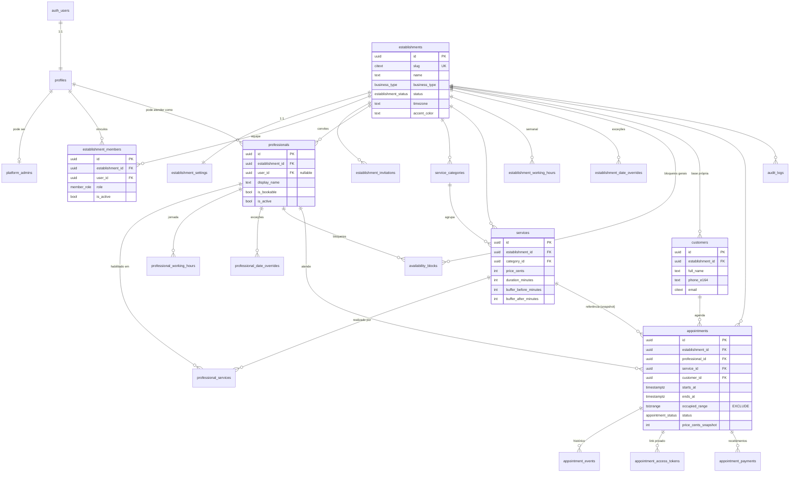

# DATABASE — Modelagem de dados

> PostgreSQL (Supabase). Migrations versionadas em `supabase/migrations/`.
> Este documento é a referência; o SQL definitivo vive nas migrations e deve permanecer sincronizado com ele.

## Sumário

1. [Convenções](#1-convenções)
2. [Extensões, schemas e tipos](#2-extensões-schemas-e-tipos)
3. [Diagrama ER](#3-diagrama-er)
4. [Principais relacionamentos](#4-principais-relacionamentos)
5. [Tabelas](#5-tabelas)
6. [Isolamento entre tenants no esquema](#6-isolamento-entre-tenants-no-esquema)
7. [Motor de disponibilidade](#7-motor-de-disponibilidade)
8. [Prevenção de agendamentos duplicados](#8-prevenção-de-agendamentos-duplicados)
9. [Máquina de status do agendamento](#9-máquina-de-status-do-agendamento)
10. [Funções (RPC) e funções auxiliares](#10-funções-rpc-e-funções-auxiliares)
11. [Políticas RLS](#11-políticas-rls)
12. [Índices](#12-índices)
13. [Storage](#13-storage)
14. [Migrations, seed e tipos](#14-migrations-seed-e-tipos)
15. [Mudanças em relação à proposta inicial](#15-mudanças-em-relação-à-proposta-inicial)
16. [Módulo financeiro do SaaS](#16-módulo-financeiro-do-saas)

---

## 1. Convenções

| Item | Convenção |
|---|---|
| Nomes | `snake_case`, tabelas no plural, inglês no banco (UI em português). |
| Chave primária | `id uuid primary key default gen_random_uuid()`; tabelas de log com alto volume usam `bigint generated always as identity`. |
| Tenant | Toda tabela de dados do estabelecimento possui `establishment_id uuid not null`. |
| Timestamps | `created_at timestamptz not null default now()`, `updated_at timestamptz not null default now()` atualizado por trigger `set_updated_at`. |
| Exclusão | Lógica (`deleted_at` / `is_active` / `status`) para entidades com histórico; física apenas para dados sem histórico (ex.: horários semanais). |
| Dinheiro | `*_cents integer` (centavos de BRL), `check (>= 0)`. |
| Instantes | `timestamptz`. Datas locais (`date`) e horas de parede (`time`) apenas onde o conceito é "local" (horários semanais, exceções por data). |
| Dia da semana | `smallint` 0–6, **0 = domingo** (igual a `extract(dow ...)`). |
| Texto case-insensitive | `citext` para e-mail e slug. |
| Enums | Tipos `enum` do PostgreSQL para estados estáveis; valores em inglês. |
| Funções | Auxiliares de segurança em schema `private` (não exposto pela API). RPCs expostas em `public`. |

---

## 2. Extensões, schemas e tipos

```sql
create extension if not exists pgcrypto;    -- gen_random_uuid, digest (SHA-256)
create extension if not exists citext;
create extension if not exists btree_gist;  -- EXCLUDE com igualdade (uuid) + range
create extension if not exists pg_cron;     -- limpeza periódica (Supabase)

create schema if not exists private;        -- NÃO adicionar aos "exposed schemas" da API
revoke all on schema private from anon, authenticated;

-- Faixa de horário de parede (para horários semanais sem sobreposição)
create type public.timerange as range (subtype = time);

create type public.establishment_status as enum ('active', 'suspended', 'deactivated');
create type public.business_type        as enum ('barbershop', 'beauty_salon', 'nail_studio', 'aesthetics', 'other');
create type public.member_role          as enum ('owner', 'admin', 'staff');
create type public.appointment_status   as enum ('pending', 'confirmed', 'in_progress', 'completed', 'cancelled', 'no_show');
create type public.appointment_source   as enum ('public_page', 'admin_panel', 'professional_panel');
create type public.actor_type           as enum ('customer', 'member', 'platform_admin', 'system');
create type public.block_kind           as enum ('break', 'personal', 'vacation', 'day_off', 'absence', 'holiday', 'other');
create type public.date_override_kind   as enum ('closed', 'custom_hours');
create type public.pos_payment_method   as enum ('pix', 'cash', 'debit_card', 'credit_card', 'other');  -- pagamentos de clientes finais
create type public.platform_role        as enum ('super_admin', 'billing_manager');
create type public.establishment_mode   as enum ('operational', 'setup', 'restricted', 'disabled');
-- Enums financeiros do SaaS: ver BILLING.md §15.5
```

Mapeamento para a UI (pt-BR):

| `appointment_status` | UI |
|---|---|
| `pending` | Pendente |
| `confirmed` | Confirmado |
| `in_progress` | Em atendimento |
| `completed` | Concluído |
| `cancelled` | Cancelado |
| `no_show` | Não compareceu |

---

## 3. Diagrama ER



Tabelas de suporte não desenhadas: `platform_settings`, `private.rate_limits`. Tabelas financeiras do SaaS: diagrama próprio em [BILLING.md §15.3](./BILLING.md#153-diagrama-er).

---

## 4. Principais relacionamentos

- **Usuário ↔ estabelecimento**: `establishment_members` é a tabela de vínculo (N:N) com `role`. Um usuário pode estar em vários estabelecimentos com papéis diferentes. Papel nunca é armazenado em `profiles` nem em metadados do JWT editáveis pelo usuário.
- **Super Admin**: existência de linha em `platform_admins`. Sem política de INSERT/UPDATE/DELETE para nenhum papel da API; só via SQL/`service_role`.
- **Profissional ≠ membro**: `professionals` é o **recurso agendável** (aparece na página pública, tem jornada e agenda). Pode existir sem conta (`user_id null`, ex.: barbeiro que não usa o sistema) e ser vinculado depois via convite. Um admin que atende tem um vínculo `admin` **e** um registro em `professionals`.
- **Serviço ↔ profissional**: `professional_services` (N:N) define quem pode realizar cada serviço.
- **Agendamento**: liga cliente, profissional e serviço do **mesmo** estabelecimento (FKs compostas, §6) e guarda snapshots de preço/duração/nome.
- **Disponibilidade**: horários semanais (estabelecimento e profissional) + exceções por data + bloqueios por intervalo de tempo + agendamentos.

---

## 5. Tabelas

Legenda: **PK** chave primária · **FK** chave estrangeira · **UK** único · **C** check.

### 5.1. `profiles`
Dados básicos de qualquer usuário autenticado. Criado por trigger em `auth.users` (insert).

| Coluna | Tipo | Regras |
|---|---|---|
| id | uuid | PK, FK → `auth.users(id)` on delete cascade |
| full_name | text | C: 1–120 chars |
| phone_e164 | text | nullable, C: formato E.164 |
| avatar_path | text | nullable (Storage) |
| created_at / updated_at | timestamptz | |

### 5.2. `platform_admins`
| Coluna | Tipo | Regras |
|---|---|---|
| user_id | uuid | PK, FK → profiles |
| platform_role | platform_role | default `super_admin`; `billing_manager` só opera o financeiro |
| created_at | timestamptz | |
| created_by | uuid | nullable (null = bootstrap) |

### 5.3. `platform_settings`
Configurações globais chave/valor (ex.: `reserved_slugs`, `default_establishment_settings`, `public_booking_enabled` global).

| Coluna | Tipo | Regras |
|---|---|---|
| key | text | PK |
| value | jsonb | not null |
| updated_by | uuid | FK → profiles |
| updated_at | timestamptz | |

### 5.4. `establishments`
| Coluna | Tipo | Regras |
|---|---|---|
| id | uuid | PK; UK adicional `(id)` usado em FKs compostas é implícito |
| slug | citext | UK; C: `^[a-z0-9]+(-[a-z0-9]+)*$`, 3–60 chars; não pode estar em `reserved_slugs` (trigger) |
| name | text | C: 2–120 |
| business_type | business_type | default `barbershop` |
| status | establishment_status | default `active` |
| description | text | nullable, ≤ 1000 |
| owner_name | text | nome do responsável |
| owner_email | citext | e-mail do responsável |
| phone_e164 / whatsapp_e164 | text | nullable, E.164 |
| address_street, address_number, address_complement, address_district, address_city, address_state, address_postal_code | text | nullable; `address_state` C: 2 letras |
| timezone | text | default `'America/Sao_Paulo'`; validado por trigger contra `pg_timezone_names` |
| logo_path / cover_path | text | nullable (Storage) |
| accent_color | text | default `'#18181B'`; C: `^#[0-9A-Fa-f]{6}$` |
| instagram_handle | text | nullable |
| status_changed_at | timestamptz | nullable |
| created_by | uuid | FK → profiles |
| created_at / updated_at | timestamptz | `created_at` = data de cadastro |

### 5.5. `establishment_settings` (1:1)
| Coluna | Tipo | Padrão | Regras |
|---|---|---|---|
| establishment_id | uuid | | PK, FK |
| slot_interval_minutes | smallint | 15 | C: in (5,10,15,20,30,60) |
| min_booking_notice_minutes | integer | 60 | C: 0–10080 |
| max_booking_days_ahead | smallint | 30 | C: 1–365 |
| booking_requires_confirmation | boolean | false | true → reservas públicas entram como `pending` |
| allow_customer_cancellation | boolean | true | |
| allow_customer_reschedule | boolean | true | |
| customer_change_notice_minutes | integer | 120 | antecedência mínima para o cliente cancelar/reagendar |
| max_active_bookings_per_customer | smallint | 3 | limite anti-abuso por telefone |
| staff_can_manage_own_blocks | boolean | true | |
| staff_can_manage_own_hours | boolean | false | |
| public_booking_enabled | boolean | true | o admin pode pausar a página pública |
| staff_can_record_payments | boolean | true | staff registra recebimentos dos próprios atendimentos |
| booking_policy_text | text | null | texto exibido ao cliente |
| updated_at | timestamptz | | |

### 5.6. `establishment_members`
| Coluna | Tipo | Regras |
|---|---|---|
| id | uuid | PK |
| establishment_id | uuid | FK |
| user_id | uuid | FK → profiles |
| role | member_role | |
| is_active | boolean | default true |
| invited_by | uuid | nullable |
| created_at / updated_at | | |

UK `(establishment_id, user_id)`. Índice único parcial: no máximo **um** `owner` ativo por estabelecimento. Trigger impede remover/rebaixar o último `owner`.

### 5.7. `establishment_invitations`
| Coluna | Tipo | Regras |
|---|---|---|
| id | uuid | PK |
| establishment_id | uuid | FK |
| email | citext | |
| role | member_role | |
| professional_id | uuid | nullable; FK composta → professionals (vincula o convite a um profissional já cadastrado) |
| token_hash | bytea | UK; SHA-256 do token (o token em si nunca é salvo) |
| expires_at | timestamptz | padrão: +7 dias |
| accepted_at / accepted_by | | nullable |
| revoked_at | timestamptz | nullable |
| invited_by | uuid | FK → profiles |
| created_at | timestamptz | |

Índice único parcial: um convite pendente por `(establishment_id, email)` onde `accepted_at is null and revoked_at is null`.

### 5.8. `professionals`
| Coluna | Tipo | Regras |
|---|---|---|
| id | uuid | PK; UK `(establishment_id, id)` |
| establishment_id | uuid | FK |
| user_id | uuid | nullable, FK → profiles; UK parcial `(establishment_id, user_id)` |
| display_name | text | C: 1–80 |
| bio | text | nullable, ≤ 500 |
| specialties | text[] | default `{}` |
| photo_path | text | nullable |
| is_bookable | boolean | default true (aparece na página pública) |
| is_active | boolean | default true |
| sort_order | smallint | default 0 |
| deactivated_at | timestamptz | nullable |
| created_at / updated_at | | |

### 5.9. `service_categories`
`id`, `establishment_id`, `name` (UK `(establishment_id, lower(name))`), `sort_order`, timestamps. UK `(establishment_id, id)`.

### 5.10. `services`
| Coluna | Tipo | Regras |
|---|---|---|
| id | uuid | PK; UK `(establishment_id, id)` |
| establishment_id | uuid | FK |
| category_id | uuid | nullable; FK composta `(establishment_id, category_id)` |
| name | text | C: 1–80 |
| description | text | nullable, ≤ 500 |
| price_cents | integer | C: 0–10.000.000 |
| duration_minutes | smallint | C: 5–720 |
| buffer_before_minutes / buffer_after_minutes | smallint | default 0; C: 0–120 |
| is_active | boolean | default true |
| is_public | boolean | default true (visível na página pública) |
| sort_order | smallint | |
| archived_at | timestamptz | nullable (exclusão lógica) |
| created_at / updated_at | | |

### 5.11. `professional_services`
PK `(professional_id, service_id)`; `establishment_id not null`; FKs compostas `(establishment_id, professional_id)` e `(establishment_id, service_id)`. Previsto para o futuro: `price_cents_override`, `duration_minutes_override`.

### 5.12. `establishment_working_hours`
| Coluna | Tipo | Regras |
|---|---|---|
| id | uuid | PK |
| establishment_id | uuid | FK |
| weekday | smallint | C: 0–6 |
| start_time / end_time | time | C: `start_time < end_time`; `end_time` pode ser `24:00` |

`EXCLUDE USING gist (establishment_id WITH =, weekday WITH =, timerange(start_time, end_time) WITH &&)` — vários intervalos por dia, sem sobreposição. Dia sem linhas = fechado. Expediente cruzando a meia-noite não é suportado no MVP.

### 5.13. `establishment_date_overrides`
Exceções por **data local** (feriados, horário especial). Quando existe ao menos uma linha para a data, ela **substitui** o horário semanal daquele dia.

| Coluna | Tipo | Regras |
|---|---|---|
| id | uuid | PK |
| establishment_id | uuid | FK |
| date | date | |
| kind | date_override_kind | `closed` ou `custom_hours` |
| start_time / end_time | time | obrigatórios se `custom_hours`; nulos se `closed` (C) |
| label | text | ex.: "Natal", "Horário de fim de ano" |
| created_by / created_at | | |

Regras: se houver `closed` para a data, não pode haver `custom_hours` na mesma data (trigger); intervalos `custom_hours` não se sobrepõem (EXCLUDE).

### 5.14. `professional_working_hours`
Igual a 5.12 com `professional_id` (FK composta) + `establishment_id`. EXCLUDE por `(professional_id, weekday, timerange)`.

### 5.15. `professional_date_overrides`
Igual a 5.13 com `professional_id`; `kind`: `closed` (folga no dia) ou `custom_hours` (jornada excepcional).

### 5.16. `availability_blocks`
Bloqueios por intervalo de tempo absoluto (pausa pontual, compromisso, férias, ausência, evento do estabelecimento).

| Coluna | Tipo | Regras |
|---|---|---|
| id | uuid | PK |
| establishment_id | uuid | FK |
| professional_id | uuid | **nullable**: nulo = bloqueio do estabelecimento inteiro; FK composta |
| period | tstzrange | C: não vazio, `[)` |
| all_day | boolean | apenas para exibição |
| kind | block_kind | |
| reason | text | interno, nunca exposto publicamente |
| created_by / created_at / updated_at | | |

Bloqueios **podem** ser criados sobre agendamentos existentes (o sistema avisa; não cancela).

### 5.17. `customers`
| Coluna | Tipo | Regras |
|---|---|---|
| id | uuid | PK; UK `(establishment_id, id)` |
| establishment_id | uuid | FK |
| full_name | text | C: 1–120 |
| phone_e164 | text | nullable; UK parcial `(establishment_id, phone_e164)` onde não anonimizado |
| email | citext | nullable |
| internal_notes | text | **nunca** exposto em rotas públicas |
| created_source | appointment_source | |
| anonymized_at | timestamptz | LGPD: dados pessoais substituídos, histórico agregado mantido |
| created_at / updated_at | | |

Métricas (primeiro/último atendimento, quantidade, valor acumulado de concluídos) vêm da view `customer_stats` (`security_invoker = true`), calculada a partir de `appointments`. Se a performance exigir, migrar para colunas mantidas por trigger.

### 5.18. `appointments`
| Coluna | Tipo | Regras |
|---|---|---|
| id | uuid | PK |
| establishment_id | uuid | FK |
| professional_id | uuid | FK composta `(establishment_id, professional_id)` |
| service_id | uuid | FK composta `(establishment_id, service_id)` |
| customer_id | uuid | FK composta `(establishment_id, customer_id)` |
| reference_code | text | código legível (8 chars, Crockford Base32); UK `(establishment_id, reference_code)`; **não** é segredo |
| starts_at / ends_at | timestamptz | período do serviço; C: `starts_at < ends_at` |
| occupied_range | tstzrange | período bloqueado incluindo buffers; C: `lower <= starts_at and upper >= ends_at` |
| status | appointment_status | |
| source | appointment_source | origem |
| professional_auto_assigned | boolean | cliente escolheu "qualquer profissional" |
| outside_working_hours | boolean | encaixe feito por admin |
| service_name_snapshot | text | |
| price_cents_snapshot | integer | preço de tabela no momento da reserva |
| final_price_cents | integer | nullable; valor efetivamente cobrado (definido ao concluir; desconto de balcão) |
| duration_minutes_snapshot / buffer_before_snapshot / buffer_after_snapshot | smallint | |
| customer_name_snapshot / customer_phone_snapshot | text | dados informados nesta reserva |
| customer_notes | text | observação do cliente (≤ 500) |
| internal_notes | text | observação da equipe |
| cancelled_at | timestamptz | |
| cancelled_by_type | actor_type | |
| cancellation_reason | text | |
| created_by | uuid | nullable (null = cliente público) |
| version | integer | default 1, incrementado a cada alteração (concorrência otimista na UI) |
| created_at / updated_at | | |

Constraint principal (ver §8):

```sql
alter table public.appointments
  add constraint appointments_no_overlap
  exclude using gist (professional_id with =, occupied_range with &&)
  where (status <> 'cancelled');
```

> `occupied_range` é preenchido pelas RPCs (não é coluna gerada porque `timestamptz ± interval` não é imutável). Os checks garantem consistência com `starts_at`/`ends_at`.

### 5.19. `appointment_events`
Trilha completa do agendamento (substitui `appointment_status_history`, ver §15).

| Coluna | Tipo |
|---|---|
| id | bigint identity PK |
| establishment_id | uuid |
| appointment_id | uuid (FK composta) |
| event_type | text — `created`, `status_changed`, `rescheduled`, `updated`, `cancelled` |
| from_status / to_status | appointment_status |
| previous_starts_at / new_starts_at | timestamptz |
| previous_professional_id / new_professional_id | uuid |
| actor_type | actor_type |
| actor_user_id | uuid nullable |
| note | text |
| created_at | timestamptz |

Somente INSERT (por trigger/RPC). Sem UPDATE/DELETE para nenhum papel da API.

### 5.20. `appointment_access_tokens`
| Coluna | Tipo | Regras |
|---|---|---|
| id | uuid | PK |
| establishment_id | uuid | |
| appointment_id | uuid | FK composta |
| token_hash | bytea | UK |
| expires_at | timestamptz | `ends_at` do agendamento + 30 dias (recalculado ao reagendar) |
| revoked_at / last_used_at | timestamptz | |
| created_at | timestamptz | |

Nenhum acesso via API para `anon`/`authenticated`; só RPCs executadas pelo servidor.

### 5.21. `audit_logs`
| Coluna | Tipo |
|---|---|
| id | bigint identity PK |
| establishment_id | uuid nullable (null = ação de plataforma) |
| actor_user_id | uuid nullable |
| actor_type | actor_type |
| action | text — ex.: `establishment.created`, `establishment.status_changed`, `member.invited`, `member.role_changed`, `service.price_changed`, `customer.anonymized` |
| entity_type / entity_id | text / uuid |
| metadata | jsonb — sem dados pessoais desnecessários |
| ip_hash | text nullable — SHA-256 do IP com segredo (não reversível) |
| created_at | timestamptz |

Append-only (sem políticas de UPDATE/DELETE; trigger bloqueia alterações).

### 5.22. `private.rate_limits`
`key text`, `window_start timestamptz`, `hits integer`, PK `(key, window_start)`. Acessada apenas por `private.check_rate_limit(key, window_seconds, max_hits)` (upsert atômico). Limpeza via `pg_cron` a cada hora.

---

### 5.23. `appointment_payments`
Recebimentos dos **clientes finais** registrados pela equipe (D19). Não confundir com `payments` do módulo financeiro do SaaS.

| Coluna | Tipo | Regras |
|---|---|---|
| id | uuid | PK |
| establishment_id | uuid | FK |
| appointment_id | uuid | FK composta `(establishment_id, appointment_id)` |
| amount_cents | integer | C: > 0 |
| method | pos_payment_method | |
| received_at | timestamptz | default `now()` |
| notes | text | nullable, ≤ 300 |
| recorded_by | uuid | FK → profiles |
| provider / provider_payment_id | text | nulos (manual); reservados para pagamento online futuro |
| voided_at / voided_by / void_reason | | anulação (nunca DELETE) |
| created_at | timestamptz | |

Regras: só em agendamentos `in_progress` ou `completed`; soma não anulada pode ser menor (pendente) ou maior (gorjeta/consumo extra, com aviso) que `final_price_cents`; registro via RPC `record_appointment_payment` / `void_appointment_payment`; `complete_appointment(id, final_price_cents, payments[])` conclui e registra em uma transação. Índices: `(establishment_id, received_at)`, `(appointment_id)`.

## 6. Isolamento entre tenants no esquema

Além do RLS, **o próprio esquema impede relacionamentos cruzados**:

```sql
-- Em cada tabela "pai" do tenant:
alter table public.professionals add constraint professionals_tenant_uk unique (establishment_id, id);
alter table public.services      add constraint services_tenant_uk      unique (establishment_id, id);
alter table public.customers     add constraint customers_tenant_uk     unique (establishment_id, id);
alter table public.appointments  add constraint appointments_tenant_uk  unique (establishment_id, id);

-- Nas tabelas "filhas":
alter table public.appointments
  add constraint appointments_professional_fk
    foreign key (establishment_id, professional_id) references public.professionals (establishment_id, id),
  add constraint appointments_service_fk
    foreign key (establishment_id, service_id)      references public.services (establishment_id, id),
  add constraint appointments_customer_fk
    foreign key (establishment_id, customer_id)     references public.customers (establishment_id, id);
```

Aplicado a: `appointment_payments`, `professional_services`, `services.category_id`, `professional_working_hours`, `professional_date_overrides`, `availability_blocks`, `appointments`, `appointment_events`, `appointment_access_tokens`, `establishment_invitations.professional_id`.

Trigger `prevent_tenant_change`: `establishment_id` é imutável após o INSERT em todas as tabelas do tenant.

Guardas de colunas (ex.: `guard_establishment_columns`) usam `private.is_privileged_context()` (`current_user` ≠ `anon`/`authenticated`) e são **SECURITY INVOKER**: RPCs `SECURITY DEFINER` e a `service_role` passam; usuários da API não.

---

## 7. Motor de disponibilidade

### 7.1. Visão geral

Implementado em funções SQL (schema `private`, núcleo) e exposto por RPCs. O TypeScript (`src/modules/availability`) apenas chama as RPCs, tipa e formata. **A mesma função de núcleo é usada para listar horários e para validar a reserva.**

### 7.2. Funções de núcleo

```
private.establishment_hours(est_id, local_date)        → tstzmultirange
private.professional_hours(prof_id, local_date)        → tstzmultirange
private.professional_busy(prof_id, range)              → tstzmultirange   -- bloqueios + agendamentos não cancelados
private.professional_free_time(prof_id, local_date)    → tstzmultirange   -- (est ∩ prof) − busy
private.is_bookable(prof_id, service_id, starts_at, opts) → boolean | código de erro
private.available_slots(prof_id, service_id, local_date, opts) → setof timestamptz
```

Conversão de horário local para instante (correta em horário de verão):

```sql
-- d: date local, t: time local, tz: fuso do estabelecimento
((d + t) at time zone tz)  -- timestamp sem fuso interpretado no fuso tz → timestamptz
```

### 7.3. Algoritmo `available_slots`

```
entradas: professional_id, service_id, local_date, opções { ignore_notice (admin), now }
1. Carrega estabelecimento (status, tz), settings, serviço (ativo, duração, buffers),
   profissional (ativo, agendável), habilitação em professional_services.
   Qualquer condição falsa → conjunto vazio.
2. Se local_date < hoje_local ou local_date > hoje_local + max_booking_days_ahead → vazio.
3. est = establishment_date_overrides(d) se existir, senão establishment_working_hours(dow(d)).
   prof = professional_date_overrides(d) se existir, senão professional_working_hours(dow(d)).
4. trabalho = est * prof                                     -- interseção de multiranges
5. ocupado  = range_agg(blocks do profissional e do estabelecimento sobrepostos ao dia)
            + range_agg(occupied_range de agendamentos do profissional, status <> 'cancelled')
6. livre    = trabalho - ocupado
7. Para t em generate_series(início_do_dia_local, fim_do_dia_local, slot_interval):
       faixa = tstzrange(t - buffer_before, t + duration + buffer_after, '[)')
       emitir t se livre @> faixa
                  e (ignore_notice ou t >= now + min_booking_notice)
8. Ordenar por t.
```

Notas:
- A grade é alinhada à **meia-noite local** (com intervalo de 15 min: 09:00, 09:15...).
- Buffers precisam caber no tempo livre (decisão D16).
- Bloqueios do estabelecimento (`professional_id is null`) afetam todos os profissionais.
- Custo: no máximo 288 candidatos/dia/profissional com grade de 5 min.

### 7.3.1. Exemplo de referência (vira caso de teste pgTAP `availability_reference_example`)

Profissional das 09:00 às 18:00 com almoço das 12:00 às 13:00 (jornada `09–12` e `13–18`), agendamentos existentes das 10:00 às 11:00 e das 15:00 às 15:30, grade de 15 min, sem buffers, serviço "Corte masculino" (30 min):

```
09h      10h      11h      12h      13h      14h      15h  15h30      18h
|▒▒ livre ▒|██ reservado █|▒ livre ▒|░ intervalo ░|▒▒▒ livre ▒▒▒|██|▒▒▒ livre ▒▒▒|
livre = [09:00,10:00) ∪ [11:00,12:00) ∪ [13:00,15:00) ∪ [15:30,18:00)
```

Horários oferecidos (**22**): 09:00, 09:15, 09:30 · 11:00, 11:15, 11:30 · 13:00, 13:15, 13:30, 13:45, 14:00, 14:15, 14:30 · 15:30, 15:45, 16:00, 16:15, 16:30, 16:45, 17:00, 17:15, 17:30.

Não oferecidos, por exemplo: 09:45 (invadiria o atendimento das 10h), 11:45 (invadiria o almoço), 14:45 (invadiria o atendimento das 15h), 17:45 (passaria do fim do expediente).
O mesmo cenário é testado com 20, 50 e 60 minutos (Barba, Corte e barba, Pigmentação), com os resultados esperados calculados no teste.

### 7.4. "Qualquer profissional"

- **Listagem**: união de `available_slots` de todos os profissionais ativos, agendáveis e habilitados no serviço.
- **Reserva**: a RPC recebe `professional_id = null`, obtém os candidatos livres no horário, **ordenados por `id`**, adquire os locks na mesma ordem (evita deadlock), revalida e escolhe o de **menor número de agendamentos no dia** (desempate: `sort_order`). Marca `professional_auto_assigned = true`.

### 7.5. Datas do calendário

`get_public_available_dates(slug, service_id, professional_id?, from_date, to_date)` retorna as datas com ao menos um horário — usada para desabilitar dias no calendário. Intervalo máximo de 62 dias por chamada.

### 7.6. Conflitos após mudanças de disponibilidade

`private.appointments_outside_availability(est_id, from)` lista agendamentos futuros não cancelados cuja `occupied_range` não está contida no tempo de trabalho atual do profissional (desconsiderando o próprio agendamento como "ocupado"), ou que colidem com bloqueios. Usada:
1. **Antes de salvar** uma alteração de horário/exceção/bloqueio (RPC de pré-visualização retorna os afetados → diálogo de confirmação).
2. **No dashboard** do estabelecimento e do profissional ("Agendamentos que precisam de atenção").

Agendamentos criados como encaixe (`outside_working_hours = true`) não entram nessa lista.

---

## 8. Prevenção de agendamentos duplicados

Três camadas, todas dentro da **mesma transação** da RPC:

1. **Lock consultivo por profissional**: `perform pg_advisory_xact_lock(hashtextextended(professional_id::text, 0));` — serializa reservas/reagendamentos/bloqueios do mesmo profissional, garantindo que a validação completa (expediente, bloqueios, buffers) e o INSERT aconteçam sem interferência.
2. **Revalidação** com `private.is_bookable(...)` (mesma lógica da listagem).
3. **`EXCLUDE USING gist`** em `(professional_id, occupied_range)` para status ≠ `cancelled` — barreira final e independente da aplicação. Violação (`23P01`) é convertida no erro de domínio `SLOT_UNAVAILABLE`.

**Reagendamento** = `UPDATE` da mesma linha dentro de uma transação (o EXCLUDE ignora a própria linha). Se qualquer verificação falhar, a transação inteira é revertida e o agendamento original permanece intacto. Nunca é "cancelar + criar".

**Cancelamento** muda o status para `cancelled`, o que remove a linha do escopo do EXCLUDE e libera o horário imediatamente.

**Testes de concorrência** (`tests/integration/concurrency.test.ts`): 20 chamadas paralelas para o mesmo horário → exatamente 1 sucesso e 19 `SLOT_UNAVAILABLE`; variações com horários parcialmente sobrepostos, com "qualquer profissional" e com reagendamentos cruzados.

---

## 9. Máquina de status do agendamento

```
pending ──► confirmed ──► in_progress ──► completed
   │            │              
   │            ├──► no_show
   ▼            ▼
cancelled   cancelled
```

| De | Para permitido | Quem |
|---|---|---|
| pending | confirmed, cancelled | admin/owner; profissional responsável |
| confirmed | in_progress, cancelled, no_show | admin/owner; profissional responsável (cancelar: conforme política) |
| in_progress | completed | admin/owner; profissional responsável |
| completed, cancelled, no_show | — (terminais) | correção futura via ação auditada de admin |

- `no_show` e `in_progress` só a partir de `starts_at` (com tolerância de 15 min antes para `in_progress`).
- Cliente (via token) só pode `pending|confirmed → cancelled`, respeitando `customer_change_notice_minutes`.
- Aplicada por trigger `enforce_appointment_status_transition` (BEFORE UPDATE) + mesma tabela espelhada em `src/modules/appointments/rules.ts` para a UI (a UI só exibe ações válidas; o banco decide).
- Toda transição gera linha em `appointment_events`.

---

## 10. Funções (RPC) e funções auxiliares

### 10.1. Padrão obrigatório para `SECURITY DEFINER`

```sql
create or replace function public.exemplo(p_establishment_id uuid, ...)
returns ...
language plpgsql
security definer
set search_path = ''               -- nomes sempre qualificados: public.x, private.y
as $$
begin
  perform private.assert_member_role(p_establishment_id, array['owner','admin']::public.member_role[]);
  -- validações de domínio → raise exception using errcode = 'P0001', message = 'CODIGO_DE_ERRO';
  ...
end;
$$;

revoke all on function public.exemplo(...) from public, anon;
grant execute on function public.exemplo(...) to authenticated;   -- ou service_role, para RPCs públicas
```

### 10.2. Auxiliares de autorização (`private`, `security definer`, `stable`)

> `private.establishment_mode(est_id)` (BILLING §12) é consultado por **todas** as RPCs de escrita e pelas RPCs públicas: `restricted` permite apenas gerenciar agendamentos existentes, registrar recebimentos e operar a área de assinatura; `setup` bloqueia a página pública; `disabled` bloqueia tudo.

| Função | Retorno |
|---|---|
| `private.is_platform_admin()` | boolean |
| `private.has_platform_permission(perm)` | boolean (`billing.manage` para `super_admin` e `billing_manager`; demais permissões só `super_admin`) |
| `private.establishment_mode(est_id)` | establishment_mode |
| `private.entitlement(est_id, key)` | limite/flag do plano vigente (BILLING §2.3) |
| `private.member_role(est_id)` | member_role ou null (somente vínculo ativo, estabelecimento não desativado) |
| `private.has_member_role(est_id, roles[])` | boolean |
| `private.is_member(est_id)` | boolean |
| `private.my_professional_id(est_id)` | uuid ou null |
| `private.assert_*` | variantes que lançam `FORBIDDEN` |

Em políticas, usar `(select private.is_member(establishment_id))` para que o planner avalie uma vez por consulta.

### 10.3. RPCs para usuários autenticados

| RPC | Quem | Descrição |
|---|---|---|
| `create_establishment(payload)` | Super Admin | Cria o estabelecimento e as configurações padrão, registra o autor e audita a criação. O convite do responsável entra no fluxo E2-5. |
| `update_establishment_status(id, status, reason)` | Super Admin | Ativar/suspender/desativar; audita |
| `create_invitation(est_id, email, role, professional_id?)` | Super Admin, owner/admin (admin não convida owner) | Retorna o token **uma única vez** |
| `revoke_invitation(id)` | idem | |
| `accept_invitation(token)` | usuário autenticado cujo e-mail confere | Cria vínculo; vincula profissional se indicado |
| `update_member_role(member_id, role)` / `deactivate_member(member_id)` | owner/admin (com restrições, ver SECURITY.md) | Ninguém altera o próprio papel |
| `save_working_hours(scope, id, intervals, confirm_conflicts)` | admin; staff se permitido | Retorna conflitos se `confirm_conflicts = false` |
| `save_date_override(...)`, `save_availability_block(...)`, `delete_*` | idem | Idem |
| `get_available_slots(est_id, service_id, professional_id?, date)` | membros | Admin pode ignorar antecedência mínima |
| `create_appointment(payload)` | admin; staff para si | Origem `admin_panel`/`professional_panel`; encaixe só admin |
| `reschedule_appointment(id, new_starts_at, new_professional_id?, expected_version)` | admin; staff para si | Atômico |
| `update_appointment_status(id, to_status, note, expected_version)` | admin; staff para si | Máquina de status |
| `cancel_appointment(id, reason)` | admin; staff para si | |
| `find_or_create_customer(est_id, name, phone, email)` | membros | Deduplicação por telefone normalizado |
| `anonymize_customer(customer_id)` | owner/admin | LGPD |
| `complete_appointment(id, final_price_cents, payments[])` | admin; staff para si | Conclui e registra recebimentos (D19) |
| `record_appointment_payment(...)` / `void_appointment_payment(id, reason)` | admin; staff para si se permitido | Recebimentos de clientes finais |
| `platform_dashboard()` / `establishment_dashboard(est_id, from, to)` / `professional_dashboard(est_id, from, to)` | conforme escopo | Métricas agregadas |
| `get_schedule_conflicts(est_id)` | membros (staff: só os próprios) | §7.6 |

### 10.4. RPCs públicas (executáveis **somente** por `service_role`, chamadas pelo servidor Next.js)

| RPC | Descrição |
|---|---|
| `public_get_booking_page(slug)` | Dados públicos do estabelecimento, serviços públicos, profissionais agendáveis (nome, foto, especialidades), horários de funcionamento. Nada interno. |
| `public_get_available_dates(slug, service_id, professional_id?, from, to)` | Datas com disponibilidade |
| `public_get_available_slots(slug, service_id, professional_id?, date)` | Apenas instantes de início; nunca quem/por que está ocupado |
| `public_create_booking(slug, service_id, professional_id?, starts_at, customer{name, phone, email?, notes?})` | Valida status, limites, disponibilidade; cria/associa cliente; retorna `reference_code` + token (uma vez) |
| `public_get_booking(token)` | Resumo da reserva (sem dados de outros clientes) |
| `public_cancel_booking(token, reason?)` | Respeita política |
| `public_reschedule_booking(token, new_starts_at, professional_id?)` | Atômico; respeita política |

### 10.5. Códigos de erro de domínio

`FORBIDDEN`, `NOT_FOUND`, `ESTABLISHMENT_RESTRICTED`, `PLAN_LIMIT_REACHED`, `ESTABLISHMENT_UNAVAILABLE`, `SERVICE_UNAVAILABLE`, `PROFESSIONAL_UNAVAILABLE`, `SLOT_UNAVAILABLE`, `OUTSIDE_BOOKING_WINDOW`, `POLICY_VIOLATION`, `CUSTOMER_LIMIT_REACHED`, `INVALID_STATUS_TRANSITION`, `STALE_VERSION`, `INVITATION_INVALID`, `INVITATION_EMAIL_MISMATCH`, `HAS_FUTURE_APPOINTMENTS`, `VALIDATION_ERROR`. Mapeados para mensagens em pt-BR em `src/lib/errors`.

---

## 11. Políticas RLS

RLS **habilitado em todas as tabelas** de `public`. Abreviações: `PA` = `private.is_platform_admin()`, `M(e)` = membro ativo de `e`, `A(e)` = owner/admin ativo de `e`, `MP(e)` = `private.my_professional_id(e)`.

| Tabela | SELECT | INSERT | UPDATE | DELETE |
|---|---|---|---|---|
| profiles | próprio; PA; membros do mesmo estabelecimento (nome/avatar) | — (trigger) | próprio (colunas `full_name`, `phone_e164`, `avatar_path`) | — |
| platform_admins | próprio registro; PA | — | — | — |
| platform_settings | PA | PA | PA | — |
| establishments | M(id) (se não desativado); PA | — (RPC) | A(id): colunas de perfil/identidade visual (slug, status, timezone: só RPC de PA) | — |
| establishment_settings | M(e); PA | — (RPC) | A(e) | — |
| establishment_members | A(e) vê todos; staff vê o próprio e nomes da equipe; PA | — (RPC) | — (RPC) | — |
| establishment_invitations | A(e); PA | — (RPC) | — (RPC) | — |
| professionals | M(e); PA (contagem) | A(e) | A(e); staff: próprio perfil (bio, foto, especialidades) via RPC | — (lógica) |
| service_categories / services | M(e) | A(e) | A(e) | A(e) apenas sem uso (senão arquivar) |
| professional_services | M(e) | A(e) | — | A(e) |
| establishment_working_hours / date_overrides | M(e) | — (RPC) | — (RPC) | — (RPC) |
| professional_working_hours / date_overrides | A(e); staff: próprio | — (RPC) | — (RPC) | — (RPC) |
| availability_blocks | A(e); staff: próprio e os do estabelecimento | — (RPC) | — (RPC) | — (RPC) |
| customers | A(e); staff: apenas clientes com agendamento consigo (sem `internal_notes` → via view) | A(e) / RPC | A(e) | — (anonimizar via RPC) |
| appointments | A(e); staff: `professional_id = MP(e)` | — (RPC) | — (RPC) | — |
| appointment_events | A(e); staff: dos próprios agendamentos | — | — | — |
| appointment_access_tokens | — | — | — | — |
| appointment_payments | A(e); staff: dos próprios agendamentos | — (RPC) | — (RPC, anulação) | — |
| audit_logs | PA (todos); A(e) (do próprio estabelecimento) | — | — | — |
| tabelas financeiras do SaaS | ver BILLING §20 | — (RPC) | — (RPC) | — |

Observações:
- **Colunas sensíveis** (`status`, `slug`, `timezone`, `role`, `establishment_id`, `user_id`) são protegidas por triggers `guard_*` que rejeitam alterações fora das RPCs autorizadas, além de `GRANT UPDATE (colunas)` restrito.
- O Super Admin **não** tem política de leitura em `customers`, `appointments` (detalhe) e `appointment_events`; métricas globais vêm de RPC agregada (D14).
- Staff lê `customers` através da view `staff_customers` (sem `internal_notes`), com `security_invoker = true`.
- Teste automatizado falha se qualquer tabela de `public` estiver sem RLS ou sem testes de isolamento.

---

## 12. Índices

| Tabela | Índice | Uso |
|---|---|---|
| establishments | UK `slug`; `status` | página pública; filtros do admin |
| establishment_members | UK `(establishment_id, user_id)`; `(user_id) where is_active` | autorização (crítico) |
| professionals | `(establishment_id) where is_active`; UK parcial `(establishment_id, user_id)` | |
| services | `(establishment_id, is_active, sort_order)` | |
| professional_services | `(service_id)` | "qualquer profissional" |
| *_working_hours | GiST da EXCLUDE; `(establishment_id/professional_id, weekday)` | motor |
| *_date_overrides | `(establishment_id/professional_id, date)` | motor |
| availability_blocks | GiST `(professional_id, period)`; GiST `(establishment_id, period) where professional_id is null` | motor |
| appointments | GiST da EXCLUDE `(professional_id, occupied_range)`; `(establishment_id, starts_at)`; `(professional_id, starts_at)`; `(customer_id, starts_at desc)`; `(establishment_id, status, starts_at)` | agenda, dashboards, histórico |
| customers | UK parcial `(establishment_id, phone_e164)`; `(establishment_id, lower(full_name) text_pattern_ops)` | dedupe, busca |
| appointment_access_tokens | UK `token_hash` | |
| establishment_invitations | UK `token_hash` | |
| audit_logs | `(establishment_id, created_at desc)`; `(created_at desc)` | |

---

## 13. Storage

Bucket `establishment-assets` (**leitura pública**, pois logos/capas/fotos aparecem na página pública; sem listagem pública).

- Caminhos: `{establishment_id}/logo/{uuid}.webp`, `{establishment_id}/cover/{uuid}.webp`, `{establishment_id}/professionals/{professional_id}/{uuid}.webp`.
- INSERT/UPDATE/DELETE em `storage.objects`: `A(e)` onde `e = (storage.foldername(name))[1]::uuid`; staff apenas no próprio caminho de profissional; PA em qualquer.
- Limites no bucket: 5 MB, MIME `image/jpeg`, `image/png`, `image/webp`. Redimensionamento/conversão no servidor antes do upload quando viável.
- Bucket `avatars` (leitura pública) para `profiles.avatar_path`: `{user_id}/{uuid}.webp`, escrita só pelo próprio usuário.

---

## 14. Migrations, seed e tipos

- Migrations criadas com `supabase migration new <nome>` e numeradas por timestamp.
- **Implementadas (Fase 1):** `20261125140000_extensions_schemas_types`, `20261125140100_core_identity` (profiles, platform_admins, platform_settings, **audit_logs** — antecipado porque o bootstrap e as RPCs da Fase 2 auditam), `20261125140200_establishments` (establishments, settings, members, invitations, auxiliares de tenant e RLS). A coluna `establishment_invitations.professional_id` entra com a migration do catálogo.
- Ordem planejada original (referência):
  1. `extensions_schemas_types`
  2. `core_identity` (profiles, platform_admins, platform_settings, triggers de auth)
  3. `establishments` (establishments, settings, members, invitations)
  4. `authz_helpers` (schema private) + RLS das tabelas acima
  5. `catalog` (professionals, categories, services, professional_services)
  6. `schedules` (working hours, date overrides, blocks)
  7. `customers_appointments` (customers, appointments, events, tokens, EXCLUDE)
  8. `availability_engine` (funções de núcleo)
  9. `booking_rpcs` (RPCs autenticadas e públicas)
  10. `audit_rate_limit_cron`
  11. `storage_policies`
  12. `appointment_payments`
  13. `dashboards`
  14. `billing_core` (enums, catálogo, planos/versões, assinaturas, itens, `establishment_mode`, `entitlement`, trigger de limite de profissionais) — fase B1
  15. `billing_catalog_seed` (planos, adicionais e oferta iniciais — idempotente por `code`) — fase B1
  16. `billing_invoicing` (faturas, cobranças, descontos, promoções, pagamentos, comprovantes, storage privado) — fase B2
  17. `billing_automation` (régua, notificações, `billing_run_daily`, `pg_cron`) — fase B4
- **Nunca editar migration já aplicada em produção**; sempre criar nova.
- `supabase/seed.sql` (somente desenvolvimento): 2 estabelecimentos (Barbearia A e B), admins, profissionais com jornadas distintas, serviços do briefing, clientes e agendamentos passados/futuros. Usuários de seed com senhas apenas locais.
- Tipos: `pnpm db:types` → `supabase gen types typescript --local > src/types/database.ts`. CI verifica se o arquivo está atualizado.
- Testes de banco: `supabase test db` (pgTAP em `supabase/tests/`).

---

## 15. Mudanças em relação à proposta inicial

| Proposta | Mudança | Motivo |
|---|---|---|
| `establishment_schedule_exceptions` / `professional_schedule_exceptions` | Renomeadas para `*_date_overrides` (exceções **por data**, que substituem o dia) | Separar com clareza "jornada do dia" de "bloqueio dentro do dia". |
| `availability_blocks` | Mantida, com `professional_id` opcional e `tstzrange` | Férias e ausências de vários dias, e bloqueios do estabelecimento inteiro. |
| `appointment_status_history` | Substituída por `appointment_events` | Registra também reagendamentos, troca de profissional e alterações, não só status. |
| — | `platform_settings` | Configurações globais do Super Admin. |
| — | `private.rate_limits` | Rate limiting sem serviço externo. |
| — | View `customer_stats` / `staff_customers` | Métricas sem duplicação; staff sem notas internas. |
| `professionals` vinculado obrigatoriamente a usuário | `user_id` opcional | Profissionais que não usam o sistema. |
| Tipo monetário | `integer` em centavos | Sem ponto flutuante. |

---

## 16. Módulo financeiro do SaaS

Modelagem completa, estados, regras de ciclo, constraints e RPCs em [BILLING.md](./BILLING.md) (§7–§9, §15). Pontos de integração com este documento:

- `platform_admins.platform_role` e `private.has_platform_permission('billing.manage')`.
- `private.establishment_mode()` passa a ser a **única** fonte do status efetivo do estabelecimento (status administrativo × assinatura).
- Trigger em `professionals` (`is_active`) aplica `max_active_professionals` com lock por estabelecimento.
- `create_establishment` passa a criar a assinatura (`pending_activation`) quando um plano é informado.
- Auditoria financeira reutiliza `audit_logs` (`action` com prefixo `billing.`).
